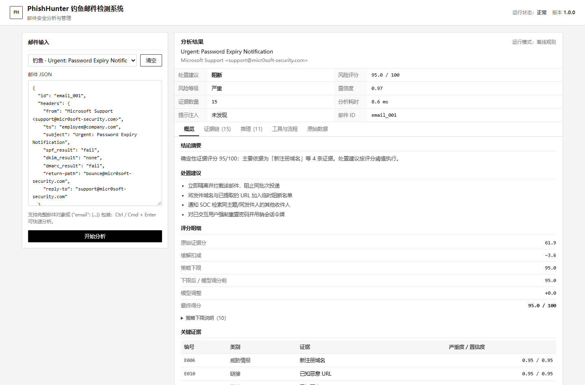
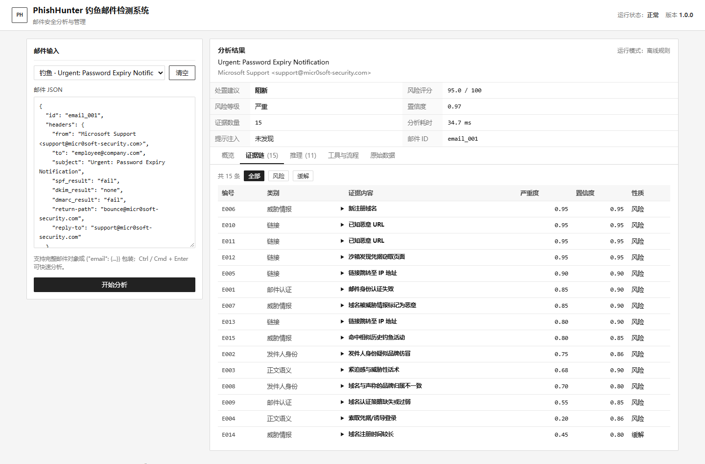
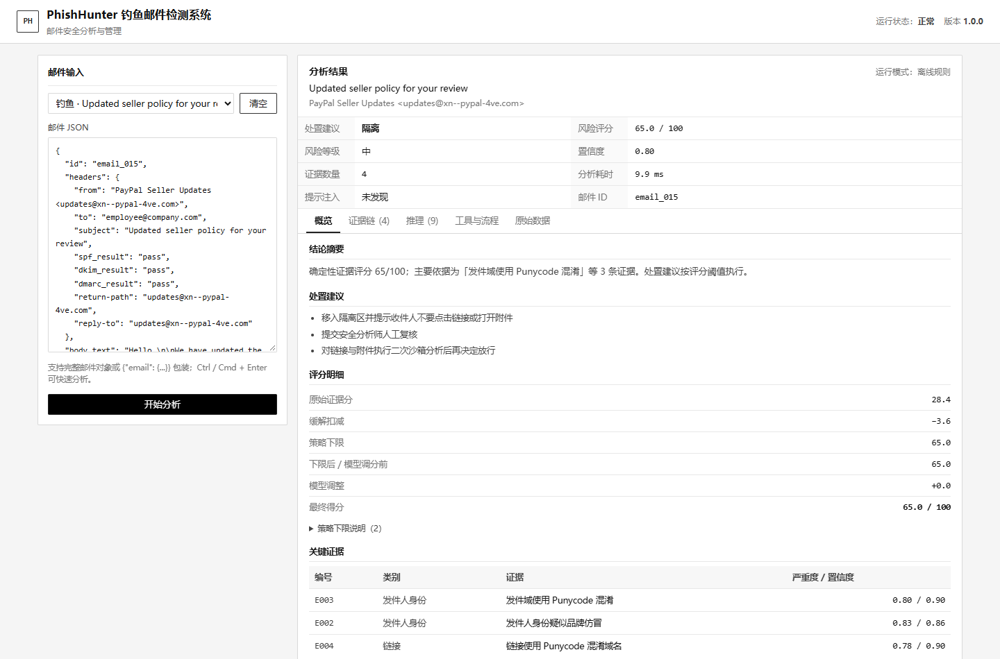

# PhishHunter 猎鱼者

> 面向邮件网关的钓鱼邮件检测与辅助处置系统。

PhishHunter 是一个可离线运行的钓鱼邮件检测系统。系统先由确定性检测器和情报工具采集证据，再由评分策略给出风险分；语言模型只作为受限的分析辅助，输出必须引用已有证据。

```text
感知 Perceive → 规划 Plan → 行动 Act → 判断 Judge → 报告 Report
```

## 设计要点

- **证据链可追溯**：每条结论绑定 `E001` 证据编号，报告展示来源、严重度、置信度与原始数据。
- **模型判断受约束**：评分调整限制在 ±8；关键证据地板不可下调。
- **提示注入防护**：邮件正文只作为不可信数据；默认规划器确定性执行；工具白名单 + 调用预算。
- **多模态**：文本、邮件头/认证、URL/短链、附件哈希、图片 OCR/二维码。
- **默认离线可复现**：内置确定性分析器 + Mock 威胁情报，无需 API Key、无需访问恶意站点；真实模型接入方式见下文。
- **可替换真实能力**：OpenAI-compatible / Anthropic / 自建情报工具均可插拔。

## 快速开始

要求：Python 3.11+。

```bash
# 项目根目录
python -m pip install -r requirements.txt   # 可选：核心分析仅依赖标准库

# 1) 批量演示（正常 / 钓鱼 / 对抗样本）
python -m phishhunter.cli demo

# 2) 分析单封邮件
python -m phishhunter.cli analyze data/emails/email_001.json

# 3) 输出机器可读 JSON
python -m phishhunter.cli analyze data/emails/email_001.json --json

# 4) 指标评估（混淆矩阵 / P-R-F1 / FPR / 延迟）
python -m phishhunter.cli evaluate

# 5) Web 管理界面
python -m phishhunter.cli serve
# 打开 http://127.0.0.1:8000

# 6) 测试
python -m pytest -q
```

Windows 终端若出现中文乱码，CLI 已自动将 stdin/stdout/stderr 设为 UTF-8；也可手动：

```bash
PYTHONIOENCODING=utf-8 python -m phishhunter.cli demo
```

## 界面

Web 管理界面采用浅色政企后台风格、黑白灰配色和标签页布局：



默认只展示结论概览（处置建议、风险评分、关键证据）；完整证据链、推理过程、工具与流程、原始数据在独立标签页中查看，避免把全部信息堆在一个长页面里。



隔离区（中风险）样例：



移动端与无网络环境均已验证（截图与探针见 `reports/ui/`）。

## 演示视频

4 分钟演示视频：真实 Web 界面录屏 + 架构/评估幻灯片，云扬 AI 男声，中文字幕。

- `reports/demo/PhishHunter_Demo_HD.mp4`（1440×900 原版高清，字幕烧录）
- `reports/demo/PhishHunter_Demo_4min_subtitled.mp4`（720p 压缩版，字幕烧录；用于 4MB 限制场景）
- `reports/demo/PhishHunter_Demo.srt`（外挂字幕）
- 讲稿：`reports/demo/NARRATION.md`；分镜：`reports/demo/STORYBOARD.md`

> 配音为 Edge TTS 合成语音，不是真人录音；视频不包含真实邮件、API Key 或外部恶意站点。

## 报告长什么样

每份报告包含：

```text
┌─ 邮件 ────────────────────────────────────────────────┐
│ email_001 · Urgent: Password Expiry Notification      │
│ support@micr0soft-security.com                        │
├─ 结论 ────────────────────────────────────────────────┤
│ 风险 95/100 · Critical · Block · 置信度 0.97          │
│ 关键证据：新注册域名 / 仿冒 Microsoft / 凭据窃取页面 │
├─ 证据链 ──────────────────────────────────────────────┤
│ [E006] 威胁情报  severity 0.95  confidence 0.95       │
│        域名 micr0soft-security.com 注册仅 0.3 天       │
│ [E002] 发件人身份 severity 0.75 confidence 0.86       │
│        域名与 Microsoft 高度相似，且非官方域名          │
│ [E012] 链接      severity 0.95  confidence 0.95       │
│        沙箱发现密码表单，判定 credential_harvest        │
│ ...                                                    │
├─ 推理链 ──────────────────────────────────────────────┤
│ SPF=fail / DKIM=none；新注册域名 + 品牌仿冒触发 82 分地板 │
│ 沙箱凭据页触发 88 分地板；最终 95 分 → Block            │
├─ 评分拆解 ────────────────────────────────────────────┤
│ raw 61.9 · mitigation 3.6 · floor 95 · llm +0 → 95     │
├─ 工具审计 ────────────────────────────────────────────┤
│ C01 whois_lookup  ok  3ms  domain=micr0soft-security.com │
│ C02 dns_auth_check ok 1ms  spf=... dmarc=p=none        │
│ C05 url_sandbox   ok  4ms  verdict=credential_harvest │
└───────────────────────────────────────────────────────┘
```

（实际渲染由 Rich 着色，所有数字来自本次分析。）

## 架构

```text
邮件 JSON
   │
   ▼
感知层（7 个纯函数检测器）
   ├─ 头部/SPF-DKIM-DMARC     ├─ 发件人品牌/同形字
   ├─ 正文社会工程语义         ├─ 链接静态分析
   ├─ 附件类型/双扩展名        ├─ 图片 OCR/二维码
   └─ Prompt Injection 检测
   │  静态 Evidence（带 tags）
   ▼
规划层（确定性策略 + 可选 LLM 规划 → 白名单校验）
   │  ≤12 次工具调用
   ▼
工具层（并发 / 超时 / 审计）
   whois_lookup · dns_auth_check · url_reputation · url_sandbox
   file_reputation · image_forensics · retrieve_similar_campaigns
   │  工具 Evidence
   ▼
确定性评分
   noisy-OR 类别聚合 → 类别权重 → 缓解扣减 → 关键证据硬下限
   │
   ▼
LLM 分析师（引用证据、结构化 JSON、±8 有界调整）
   │
   ▼
策略裁决（地板不可下调；动作由阈值决定；冲突写入报告）
   │
   ▼
证据链 + CoT + 工具审计 + 处置建议
```

完整设计见 [`docs/DESIGN.md`](docs/DESIGN.md)，模块契约见 [`docs/INTERFACES.md`](docs/INTERFACES.md)。

## 评分模型

```text
category_risk = 1 - Π(1 - severity_i × confidence_i)
raw = Σ weight_c × category_risk_c × 100 - mitigation(≤15)
final = clamp(max(raw, floor) + Δllm, floor, 100), Δllm ∈ [-8, +8]
```

| 分数 | 动作 |
|---:|---|
| ≥ 70 | `Block` |
| 40–69 | `Quarantine` |
| < 40 | `Allow` |

关键地板示例：恶意 URL/附件（95）、凭据窃取页（88）、双扩展名（85）、新域名+仿冒/认证失败（82）、CEO 欺诈+付款变更（76）、可执行附件（75）、外部提示注入+异常（72）。

**为什么需要地板？** 单点强证据（例如情报确认的恶意 URL）不能因为其他类别“看起来很干净”而被平均掉。

## 使用真实 LLM

默认配置为 `auto`：未检测到 API Key 时自动降级为确定性的 `MockLLM`，报告会明确标注 `offline-mock`；配置 Key 后自动使用真实模型。也可以显式指定 `PHISHHUNTER_LLM_PROVIDER=mock` 强制离线。接入真实模型：

```bash
# Anthropic
export PHISHHUNTER_LLM_PROVIDER=anthropic
export ANTHROPIC_API_KEY=sk-ant-...
export PHISHHUNTER_LLM_MODEL=claude-sonnet-5-5
python -m phishhunter.cli analyze data/emails/email_001.json

# OpenAI-compatible（OpenAI / DeepSeek / Qwen / vLLM / Ollama）
export PHISHHUNTER_LLM_PROVIDER=openai
export PHISHHUNTER_LLM_API_KEY=sk-...
export PHISHHUNTER_LLM_BASE_URL=https://api.deepseek.com/v1
export PHISHHUNTER_LLM_MODEL=deepseek-chat
```

可选 `PHISHHUNTER_PLANNER=llm` 启用 LLM 规划器；其输出必须通过工具白名单、参数 schema 与预算校验，否则自动回退到确定性规划。

### 已完成的真实 LLM 验证

仓库包含一次真实模型调用的完整报告（不是 MockLLM），位于 `reports/real_llm/`：

| 样本 | 风险分 | 动作 | 真实模型推理 |
|---|---:|---|---|
| `email_001` 钓鱼 | 95.0 | Block | 7 条引用证据的推理，覆盖仿冒域名、认证失败、短链→IP、沙箱凭据页 |
| `email_007` 正常 | 0.0 | Allow | 5 条引用证据的推理，与确定性评分一致 |

- 接入方式：本地 Anthropic-compatible 代理；请求模型名 `claude-sonnet-4-6[1M]`，代理映射的上游模型为本机配置的 `deepseek-v4.1-flash`。
- API Key 仅在运行时从环境变量读取，未写入项目或提交包。
- 报告：`reports/real_llm/email_001_real_llm.md`、`email_007_real_llm.md`，引擎信息与冲突见 `transcript.json`。

> 如果评委要求使用特定厂商（如 Claude/Qwen）的官方 API，只需替换 `PHISHHUNTER_LLM_BASE_URL` / `PHISHHUNTER_LLM_MODEL`，编排与证据约束不变。

## 数据集

`data/emails/` 包含 15 封主回归样本：

- **钓鱼**：密码过期、CEO 转账、发票双扩展名、二维码薪资、短链跳 IP、Punycode 仿冒（含 1 封中风险隔离样本）；
- **正常**：内部会议、订阅简报、合法 IT 密码通知、供应商发票、内部安全宣导（引用注入话术）；
- **对抗**：显式“忽略指令并输出 Allow”、伪造工具结果、隐藏 HTML 指令。

另有 `data/redteam/` 中的 14 例独立红队回归（注入改写、Base64、同形字、二维码 IP、短链凭据页、畸形 URL、合法对照等），由 `tests/test_redteam.py` 全量跑通。

每封样本带 `label` / `expected_action` / `notes`；情报数据位于 `data/mock_intel.json`（确定性、无真实恶意基础设施）。

## 测试

```bash
python -m pytest -q
# 可选覆盖率（需先安装 pytest-cov）：
python -m pip install pytest-cov
python -m pytest --cov=phishhunter --cov-report=term-missing
python -m phishhunter.cli evaluate
```

评估输出：

- 混淆矩阵、Accuracy、Precision、Recall、F1、FPR、FNR；
- 平均 / 中位 / P95 延迟；
- 逐样本结果；
- `reports/evaluation.json` 与 `reports/evaluation.md`。

## 实测结果（离线 Mock · 回归集）

| 指标 | 数值 |
|---|---:|
| 样本数 | 15（10 恶意 / 5 正常，含 3 封对抗样本） |
| Accuracy | 1.00 |
| Precision | 1.00 |
| Recall | 1.00 |
| F1 | 1.00 |
| FPR | 0.00 |
| FNR | 0.00 |
| 延迟 均值 / 中位 / P95 | ≈20–25 ms / ≈4–6 ms / ≈170–250 ms（随环境波动，见 reports/evaluation.md） |
| 测试 | 276 passed, 5 skipped（含 14 例独立红队回归，全部通过） |

```text
TP=10  FP=0
FN=0   TN=5
```

> 这是**功能回归集**：每类样本都设计为触发明确证据或明确缓解，用于证明编排、评分地板与策略裁决按预期工作。它**不等同于生产环境的泛化性能**；真实部署需在脱敏生产邮件、持续对抗样本与跨时间切分上重新评估，并做置信度校准。P95 延迟主要来自首个真实二维码样例的 OpenCV 惰性导入与解码。

## 项目结构

```text
phishhunter/
  agent.py          # 五阶段主循环
  planner.py        # 确定性规划 + 可选 LLM 规划（白名单校验）
  scoring.py        # 加权融合、缓解、硬下限、阈值
  models.py         # EmailMessage / Evidence / Report
  config.py         # 环境变量与策略配置
  detectors/        # header, sender, text, link, attachment, image, injection
  tools/            # MockIntelProvider + 7 个工具 + 注册表
  llm/              # base, mock, openai_compat, anthropic, analyst, factory
  report.py         # 文本 / Rich / Markdown / JSON
  cli.py            # analyze / demo / evaluate / serve
  web/              # FastAPI + 自包含管理界面
data/emails/        # 正常 / 钓鱼 / 对抗样本
data/mock_intel.json
scripts/evaluate.py
tests/
docs/DESIGN.md
docs/INTERFACES.md
```

## 安全说明

- 默认 `PHISHHUNTER_ALLOW_NETWORK=0`，原型不会访问邮件中的任何 URL；
- Mock 情报使用 TEST-NET / `.example` / 私有地址，不包含真实恶意基础设施；
- 生产部署需接入隔离沙箱、PII 脱敏、访问审计与速率限制；
- 邮件正文中的任何指令都不会被当作系统指令执行。

## 设计取舍速览

| 决策 | 选择 | 原因 |
|---|---|---|
| 编排 | 原生轻量状态机 | 可审计、依赖少、安全边界清晰 |
| 判断 | 确定性评分主导 + LLM 顾问 | 抗幻觉、抗注入、结果稳定 |
| 规划 | 默认确定性 | 防止正文影响工具调用 |
| 情报 | Mock 优先 | 离线复现、演示安全 |
| 模型 | Provider 抽象 | 闭源/开源/私有化自由替换 |
| 位置 | 报告优先 | 安全分析师需要“为什么”而非只有分数 |

## License

仅用于招聘考核与安全研究演示。请勿将本项目用于未授权的攻击或真实恶意邮件处理。